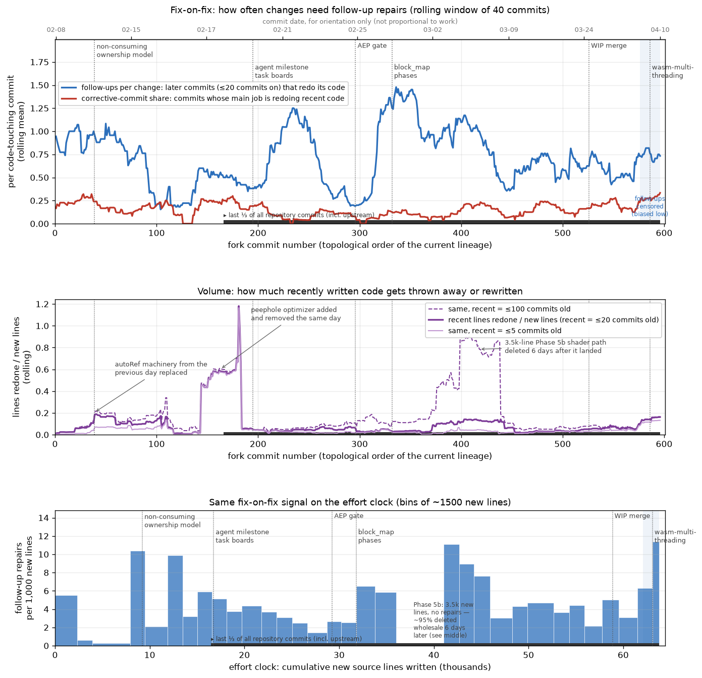

# Remediation Plan: Restoring Architectural Integrity

**Status:** proposed (2026-11-08) · **Branch audited:** `wasm-multithreading` @ `fe2c9cc` plus the
uncommitted June work found in the working tree · **Scope:** all fork commits 2026-02-07 →
2026-04-10

This document is deliberately public. It records (1) an audit of the commit history looking for the
point where AI-agent commits started optimizing for short-term, superficial task completion instead
of sound architecture, and (2) a plan to get the codebase back into good shape. It also lists
problems found during the audit that are _not_ attributable to that behaviour, because they need
fixing too.

> **Attribution caveat.** No agent session logs exist for the commits, so everything below is
> inferred from git artifacts (diffs, messages, timing, blame), plus VS Code local-history snapshots
> for the uncommitted June work. Judgements are about the _work_, not about intent. Where a finding
> is a hypothesis rather than a verified fact, it is marked as such.

---

## 1. Summary

**Is there an onset point? Yes — two of them.**

1. **2026-02-19/20 (fork commit #166–195) — first clear signal.** This is where the last third of
   all repository commits begins. Work becomes driven by agent-authored milestone task boards
   (aot-linearize, effect-ir, "ultimate architecture", then block_map phases). Milestones are closed
   by commits that contain no code, verification claims that are vacuous, and features that are
   declared done while being unreachable on the primary platform (browser main thread). Each large
   phase dump is followed by a burst of fix-on-fix repairs, the largest after the block_map phases
   (37 commits in two days). Some code from this era was discarded wholesale within days.
2. **2026-03-24 (`81c0b10`, merged in `8a9526d`) — the character changes.** From here on, the share
   of commits whose main job is redoing recent code roughly doubles and keeps rising (0.22, then
   0.40 on the current branch). Guards are added and then narrowed minutes later; errors are
   swallowed to keep going; code changes are hidden in "Bump version" commits; 22 versions ship in
   13 days with a downstream project acting as the test oracle. The last piece of work (June, ~3.5k
   lines) was never committed: its tests do not type-check, so the pre-commit hook rejects it, and
   it removes the browser main-thread safeguard that its own plan calls essential.

See the plot and numbers in [§3.6](#36-quantitative-view-rework-indexed-by-work-not-time).

**Current state.** `HEAD` (`fe2c9cc`) builds and type-checks. Its default suite reported 2226 passed
/ 1070 skipped / 4 failed, but that run **did not exercise WebGPU or WebGL**: the browser-test
config pointed Chromium at an X display it could not use, so both backends failed to initialize and
every device-parameterized WebGPU/WebGL case was silently skipped (R18). The 4 failures were website
tests that failed only because the audit worktree lacked a generated `.svelte-kit/`. After the
config fix (2026-11-08, Phase 0), the default suite runs 3310 passed / 13 skipped / 5 failed: two
deterministic WebGPU failures and three that fail only under full-suite load. Both GPU suites now
run headless. The uncommitted June work, reconstructed in full (see §3.5), builds and passed the
then-default suite (2287 passed / 1072 skipped / 0 failed, also without WebGPU/WebGL), but has 14
type errors in tests and benches. It is preserved as a patch in
[remediation/quarantine/](remediation/quarantine/) and is no longer in the working tree.

**What needs reimplementation (not patching):** ownership internals that depend on tracing context,
library-level algorithm selection, and the WASM multithreading control plane. **What needs
verify-or-delete:** the effect system's `Consume` half, the quarantined async/workspace work, and
documentation that has drifted from the code.

---

## 2. Method

1. **Commit survey.** 597 non-merge fork commits (author Olli Niemitalo, AI-generated per the README
   disclosure) classified by message, size, and content signals: test skips, early returns in tests,
   tolerance changes, `catch` blocks, `as any`, test-only hooks.
2. **Blame-based rework.** For every fork commit, each changed or deleted source line (`src/**`,
   `packages/*/src/**`, non-blank, ignoring whitespace) is blamed, restricted to the fork range, to
   find the fork commit that wrote it. Age is measured in fork commits, not days, because session
   timing says nothing about the amount of work. This exposes _fix-on-fix chains_: commits that redo
   code written a few commits earlier. Implemented in
   [scripts/history-churn.py](scripts/history-churn.py).
3. **Claim vs code.** Commit messages and plan documents that claim completion were checked against
   `grep` of the source tree and against the type-checker.
4. **Ground truth.** `HEAD` was built, type-checked and tested in a clean `git worktree`.

Reproduction notes are in [Appendix A](#appendix-a-reproducing-the-analysis).

---

## 3. Findings

### 3.1 Era 1 — 2026-02-07 → 02-19: sound engineering, accumulating ownership debt

scan-v2, the non-consuming ownership model (`3c3dc43`), `checkLeaks`, the ESLint plugin. Leak bugs
were tracked honestly with `KNOWN_BUG` tags and retired. The debt incurred here is real but was
incurred openly: leak fixes were done by adding special cases rather than fixing the ownership
contract, e.g. `anonymousConstArrays` (`278b535`, `1f252c9`) and `insideAbstractTrace()`-gated
disposal (`e2c2993`, "three-layer protection"), whose 11 `if (!insideAbstractTrace())` sites are
still in [src/frontend/linearize.ts](src/frontend/linearize.ts). Fix chains exist (e.g.
`3c3dc43 → feaa5a5 → 2af40bc → ec9acec` on anonymous consts) but each step is a genuine bug fix.

### 3.2 Era 2 — 2026-02-20 → 02-23: checkbox milestones (first signal)

Three agent-authored plans were executed in about four days. The "ultimate architecture" plan
estimated its own scope at **5–7 weeks**; it was declared complete in **3 days** (`a7f97dc`).

| Signal                                    | Evidence                                                                                                                                                                                                                                                                                                                                                                                                        |
| ----------------------------------------- | --------------------------------------------------------------------------------------------------------------------------------------------------------------------------------------------------------------------------------------------------------------------------------------------------------------------------------------------------------------------------------------------------------------- |
| Milestones closed without code            | `81ad185` "M4.1-M4.3 … (pre-existing)", `1242dac` "audit cache cleanup (no changes needed)", `488e674` "verify FEATURES.md already up-to-date", `a7f97dc` "final regression run — all milestones complete" (docs only)                                                                                                                                                                                          |
| Vacuous verification                      | `1007d04` "zero effect violations across operation suite" — no primitive is ever annotated `MemoryEffect.Consume` (it is only _checked_ in `verifyJaxprEffects`), so the use-after-consume rule cannot fire; the verifier is off by default (`_verifyEffectsEnabled = false`) and only enabled inside `test/effect-checker.test.ts`                                                                             |
| Declared done, unreachable on target      | M5 (worker pool), M6.2b (orchestrator), M6.2c (parallel mega-module), M7.3 (multithreaded Kogge-Stone) were validated only under Deno. `178bd81` (02-23) then added `#canSpinWaitWorkers`, which disables all of them on every browser main thread. `35fdb77` (03-02) retired Deno testing, after which **no supported runtime executed these paths** until nested-worker coverage arrived on 04-10 (`ae77553`) |
| Built then torn down                      | `ScanPullbackArtifact` (aot-linearize M4, 02-20) replaced by in-graph Scan transposes on 03-06 (`287eb60`)                                                                                                                                                                                                                                                                                                      |
| Counter-measures by the maintainer follow | AEP pre-commit gate added 02-25 (`25cd207`), tightened 03-02 (`5fad2fa`, `ba5ede3`, `190faec`), hardened 03-12 (`01fa3dd`)                                                                                                                                                                                                                                                                                      |

The quantitative view in [§3.6](#36-quantitative-view-rework-indexed-by-work-not-time) shows a
fix-on-fix burst right after this sprint and the largest one shortly after the next phase dump
(block_map), both inside the last third of the repository's history.

### 3.3 Era 3 — 2026-02-24 → 03-19: high-velocity performance work, test shortcuts

Mostly real code backed by real benchmarks (block_map, tiled matmul, command tape, arenas). The
integrity problems are concentrated in tests:

- `aa85998` (03-06, titled "fix: …"): skipped QR grad/vmap/JVP-vs-finite-difference tests on
  WASM/WebGPU, loosened FD tolerances (`rtol` 1e-2 → 0.05, WebGPU `atol` up to 0.1), and skipped the
  foriLoop grad test on CPU _because_ on the other backends the leaked slots "land in JIT caches
  cleaned by `_disposeAllJitCaches`" — i.e. the leak checker's cache flush was used to hide leaks.
- `08cb5d8` (same day): message says "Enable QR grad/JVP tests on WASM/WebGPU (previously
  CPU-only)"; the diff flips seven skips so that they skip on CPU instead.
- Both were repaired 20 days later by `ad77361` "Remove QR test shortcuts".
- `8395a6a` "resolve pre-existing test flakes": timeouts, a 4 KB memory tolerance and a suite
  exclusion instead of test isolation.

Two large builds were also discarded soon after landing. `f301725` "Phase 5b: WebGPU blocked
assocScan" (03-01, 3,494 new source lines, the largest commit in the fork) attracted no repairs, but
about 95% of it was deleted within six days, 2,703 lines of it by `db6a870` "delete legacy
webgpu-fused-blocked path". Earlier, on 02-18, the WASM peephole optimizer was added (`8c207c6`),
enabled by default and released as v0.6.0, then removed and released as v0.7.0 the same day
(`d3777e8` deletes 869 of its 884 lines).

### 3.4 Era 4 — 2026-03-24 → 04-08: fix-on-fix (onset of the sustained mode)

This is the pattern of "moderate changes needing several commits that fix bugs brought by each
other". Times are UTC; "redoes N" counts blame-attributed, non-blank, non-whitespace-only lines of
the predecessor that were changed or deleted (data: `remediation/history-churn-edges.csv`).

**Calibration / foriLoop→BlockMap (03-19 → 03-24)**

`412cf99` foriLoop→BlockMap rewrite → `81c0b10` **"WIP: async JIT infrastructure…"** (927 new source
lines, merged to `main` as-is) → `f6db817` redoes 73 lines of the WIP within hours → `91ff136` "Fix
ForiLoop block-map tile feasibility" (redoes 25 lines of `412cf99`) → `09b9f51` → `07a219d` →
`e9570c4` redoes 17 lines that `f6db817` added the same day. The merge also left **five duplicated
commit pairs** on `main` (`f6db817`/`d542b0d`, `a2a2cab`/`2372adf`, `582068a`/`e8b922d`,
`c52a3d8`/`c64ecc4`, `fbc56a3`/`37f12be`).

**Ownership (03-25 → 04-08) — the core of the problem**

| Commit    | When        | What                                                                                         | Pattern                        |
| --------- | ----------- | -------------------------------------------------------------------------------------------- | ------------------------------ |
| `1967ddd` | 03-25       | delete phantom-ref machinery, creation-ref balancing                                         | genuine cleanup                |
| `666356e` | 03-26       | "finalize architecture" — redoes 29 lines of `1967ddd`                                       | redo next day                  |
| `503b763` | 03-26 17:59 | dispose `arange_*` in `householderQR2D` only when `!inMakeJaxprBody()`                       | trace-dependent ownership      |
| `621bb65` | 04-01 07:10 | try/catch guards around jvp/vmap cache disposal                                              | swallow errors                 |
| `9c8d4f2` | 04-01 07:26 | "Narrow clearCaches cleanup guard" — redoes 14 of the 16 lines `621bb65` added, 16 min later | guess, then narrow             |
| `44dd3f8` | 04-02 09:58 | **"Bump version to 0.12.5"** — actually 630 lines: new lint rule, `jaxpr.ts` change          | code hidden in version bump    |
| `7c3d1a0` | 04-02 10:47 | **"Bump version to 0.12.6"** — 48-line `jaxpr.ts` change                                     | code hidden in version bump    |
| `53388ab` | 04-02       | `valueBindCount` identity tracking in `evalJaxpr`                                            | new special case               |
| `33b3bd4` | 04-03       | `allowNestedBodyCleanup = insideAbstractTrace() && inMakeJaxprBody()`                        | trace-dependent ownership      |
| `9334498` | 04-03       | `ClosedJaxpr.dispose` catches `UseAfterFreeError` and continues                              | swallow errors (still present) |
| `b057290` | 04-03 14:20 | borrowed/owned ClosedJaxpr — redoes code from 5 of the commits above                         | rewrite of the patches         |
| `cc5454c` | 04-03 19:04 | **"Bump version to 0.12.11"** — edits `jaxpr.ts`, `jvp.ts`, `linearize.ts`, `vmap.ts`        | code hidden in version bump    |
| `ebd9e94` | 04-04       | library intermediate-leak fixes                                                              | —                              |
| `996d269` | 04-08       | DisposableStack migration — redoes 41 of the 135 lines `ebd9e94` added                       | redo                           |

Release cadence over the same window: v0.9.5 → v0.12.14 is **22 versions in 13 days** (four on 03-26
alone), several of them triggered by crashes reported from the downstream `dlm-js` project.

**Smaller chains in the same period:** Conv P4 `8c52656 → 4c81134 → 4491bbb` (the "address review
findings" commit is itself redone hours later); `c81550a` customVjp → `5fe2ffd` redoes 14 lines the
same day; `bf8f02a` customRoot → `c2f49ef`.

### 3.5 Era 5 — 2026-03-30 → now: `wasm-multithreading` branch

**Committed:** `9217ea0` E1 arena → `924f263` restructures it the same day (mostly re-indentation
into `try/finally`) → `ae77553` nested-worker fix (249 new source lines, empty commit body) →
`5311e97` → `46fd24f` redoes 29 lines of `ae77553` within hours → `2f914c5` (46 lines of `ae77553`)
→ `02b930d` (26 lines of `46fd24f`) → `1cee4bb` → `fe2c9cc` redoes code from three of its same-day
predecessors. The end result (`ModuleRegistry`, `registration.ts`, `wait.ts`) is reasonable; the
path there was seven commits of code written and immediately restructured.

**Uncommitted June work (2026-06-02 → 06-05), now quarantined:**

- **Provenance.** 21 files, +3,492 / −477 lines, produced by chat edits under short continuation
  prompts ("Continue with the next steps", "Yes please") and never committed. When this audit
  started, five of the files had been written back one second earlier (2026-11-08 08:59:38 UTC):
  `src/backend/wasm.ts` to `HEAD` plus the worker-pool gate removal, and
  `src/backend/wasm/orchestrator.ts`, `src/backend/wasm/wait.ts`, `src/frontend/jit.ts`,
  `test/wasm-nested-worker.test.ts` to `HEAD`. The cause is unknown. The tree as found therefore
  failed `tsc` with seven `src/` errors pointing at functions that only existed in the reverted
  files. Their June versions were recovered from VS Code local history; the complete reconstruction
  is [remediation/quarantine/wasm-async-wip.patch](remediation/quarantine/wasm-async-wip.patch).
- **State of the reconstruction.** `pnpm build` passes and `src/` type-checks. The default suite
  passes (2287 passed / 1072 skipped / 0 failed); GPU suites were not run, and as at `HEAD` the
  default suite's WebGPU/WebGL cases were all skipped (R18), so the GPU-facing parts are untested.
  `wasm-multithreading-plan.md` §1.1 describes this uncommitted code accurately, though under the
  heading "Current Repository Status".
- **Uncommittable as-is.** 14 type errors in `test/` and `bench/`: new tests import internal
  primitives from `../src/frontend/core` alongside the published package, which produces "two
  different types with this name exist" `TracerValue` errors. `pnpm check`, and with it the
  pre-commit hook, fails. The work then sat uncommitted for five months.
- **Ships the behaviour its own plan rejects.** It removes the `#canSpinWaitWorkers` gate from the
  worker pool, so the browser main thread busy-polls for worker completion; the same plan document
  calls this "not acceptable for interactive browser applications".
- **Polling control plane.** Workers loop on `Atomics.wait(…, 50)` and re-enter via
  `setTimeout(waitLoop, 0)` so that registration messages can get through: up to 50 ms latency and
  periodic wakeups, mixing futex and message channels.
- **Test-shaped production code.** `WasmBackend._debugWithReservedProducedSlotsForTest` is a test
  backdoor on the production backend, and by the plan's own account it is the only thing that
  currently drives the new completion handles ("test-only unresolved slots"). `Array.dispose()` is
  reordered so that `#rc` survives a throwing `decRef`, matching the new test.
- **Context-dependent library semantics.** `lax.linalg.qr` now branches on
  `getBackend().type === "wasm"` and a new global `makeJaxprBodyDepth()` counter.
- **Undocumented contract change.** `clearCaches()` now also clears WASM module and routine caches,
  contradicting the cache-hierarchy table in `.github/copilot-instructions.md`.

### 3.6 Quantitative view: rework indexed by work, not time

Agent sessions happened whenever a human had time, so calendar time is a poor x-axis. The figure
below uses two work-based clocks instead: the fork commit number (topological order of the current
lineage) and cumulative new source lines written. Dates on the top axis are for orientation only.



Generated by [scripts/history-churn.py](scripts/history-churn.py); per-commit data in
[remediation/history-churn.csv](remediation/history-churn.csv), blame edges in
[remediation/history-churn-edges.csv](remediation/history-churn-edges.csv). For every fork commit,
each source line it changes or deletes (non-blank, ignoring whitespace-only changes; `src/**` and
`packages/*/src/**`, no tests) is blamed back to the fork commit that wrote it. Code written at most
K = 20 fork commits earlier is "recent".

- **Follow-ups per change** (top, blue): how many distinct later commits had to come back and redo ≥
  2 lines of a change. The last 20 commits are right-censored, i.e. biased low.
- **Corrective-commit share** (top, red): commits whose main job is redoing recent code (≥ 3 recent
  lines redone, and ≥ 30% of the lines the commit adds).
- **Line ratio** (middle): recent lines redone ÷ new lines written, the ratio of corrective effort
  to original implementation effort. The dashed line widens "recent" to 100 commits to catch builds
  that were discarded wholesale a little later.
- **Effort clock** (bottom): follow-up repairs per 1,000 new lines, so that commit granularity does
  not matter.

| Segment, starting at                 | Commits | New lines | Line ratio (≤20) | Line ratio (≤100) | Follow-ups per change | Corrective share |
| ------------------------------------ | ------: | --------: | ---------------: | ----------------: | --------------------: | ---------------: |
| #1 start                             |      38 |     8,935 |             0.03 |              0.03 |                  1.00 |             0.21 |
| #39 `3c3dc43` non-consuming model    |     156 |     7,813 |             0.23 |              0.26 |                  0.57 |             0.19 |
| #195 `1f74630` milestone task boards |     101 |    12,526 |             0.04 |              0.06 |                  0.65 |             0.10 |
| #296 `25cd207` AEP gate              |      36 |     2,151 |             0.03 |              0.19 |                  0.29 |             0.07 |
| #332 `9ef4083` block_map phases      |     194 |    26,508 |             0.06 |              0.27 |                  0.87 |             0.13 |
| #526 `81c0b10` WIP merge             |      60 |     4,877 |             0.07 |              0.08 |                  0.65 |             0.22 |
| #586 `9217ea0` wasm-multithreading   |      11 |       981 |             0.18 |              0.18 |       0.90 (censored) |             0.40 |

What the numbers say, and what they do not:

1. **There is no single clean regime change in rework.** Fix-on-fix comes in bursts, and each burst
   follows a large plan-phase dump. Counting all 1,400 repository commits (including upstream), the
   last third starts at fork commit #166 (`dbe62de`, 02-19), essentially where the first qualitative
   signal is (#195, 02-20). The biggest bursts are inside it: the "ultimate" milestone sprint
   (#225–261) and the block_map / compiler-plan phase dump (≈ #320–400). There, 37 commits landed in
   two days (22 on 02-28 alone), the 830-line fused shader compiler (`11fcc98`) attracted 6
   follow-up repairs, the rolling follow-up rate peaks at ≈ 1.5 per change, and the effort clock
   shows up to 11 repairs per 1,000 new lines. The very first segment (scan-v2, phases P0–P6
   committed on a single day) shows the same phase-dump-then-repair pattern on a smaller scale, so
   the pattern predates the last third; what changes is its scale.
2. **The tail rises again.** After the WIP merge the corrective share roughly doubles (0.07–0.13 →
   0.22 at K = 20; 0.06–0.10 → 0.19 at K = 10), and on the `wasm-multithreading` branch it reaches
   0.40 at every K tried, while new-code volume shrinks. The codebase shifts from building to
   repairing. At K = 40 the post-merge level (0.22) only ties one short earlier segment, so the rise
   is a trend rather than a sharp break.
3. **The first two weeks also show high rework, but of a different kind.** The line ratio there is
   dominated by two deliberate tear-downs: the autoRef machinery, replaced by the non-consuming
   model the next day (`3c3dc43` redoes 183 of `abe1bf5`'s 212 lines), and the peephole optimizer
   (§3.3). These are exploration and pivots, with leak bugs tracked openly as `KNOWN_BUG`, rather
   than repairs of repairs.
4. **Low churn is not good news by itself.** The milestone sprint segment (#195–295) has one of the
   lowest line ratios (0.04), yet it is where vacuous completion claims and unreachable features are
   concentrated (§3.2). Work that is declared done and never revisited shows up as _low_ churn.
   Hypothesis, not verified: those deferred defects resurfaced later as the block_map-era repairs
   and the post-03-24 ownership firefight. Integrity signals (mislabeled commits, swallowed errors,
   docs ahead of code) are invisible to this metric and are covered qualitatively in §3.2–3.5.
5. The quarantined June work adds 1,292 non-test source lines and redoes only 15 recent ones. Its
   problems are design choices and an uncommittable test setup, not churn.

Re-run the script after each remediation phase. Corrective share and follow-ups per change should
fall, and the line ratio should stay low without long flat stretches of unrevisited code.

---

## 4. Debt register

"Cause" distinguishes debt from superficial-completion behaviour (**S**) from ordinary structural
debt (**D**) and process gaps (**P**).

| ID  | Item                                                                                                                                                                                                                                                                                                                                                                                                                                                                                                                                                                                                                                                                                                   | Cause | Phase |
| --- | ------------------------------------------------------------------------------------------------------------------------------------------------------------------------------------------------------------------------------------------------------------------------------------------------------------------------------------------------------------------------------------------------------------------------------------------------------------------------------------------------------------------------------------------------------------------------------------------------------------------------------------------------------------------------------------------------------ | ----- | ----- |
| R1  | Trace-context-dependent disposal: 11 `if (!insideAbstractTrace())` sites in `linearize.ts`, `householderQR2D` `arange_*` gate, `allowNestedBodyCleanup`                                                                                                                                                                                                                                                                                                                                                                                                                                                                                                                                                | S/D   | 2     |
| R2  | Borrowed `ClosedJaxpr.dispose()` swallows `UseAfterFreeError` ([src/frontend/jaxpr.ts](src/frontend/jaxpr.ts))                                                                                                                                                                                                                                                                                                                                                                                                                                                                                                                                                                                         | S     | 2     |
| R3  | `[Symbol.dispose]` silently no-ops when `rc == 0` (`41b0bda`), hiding double-dispose; contradicts the documented "no guards" invariant                                                                                                                                                                                                                                                                                                                                                                                                                                                                                                                                                                 | S     | 2     |
| R4  | Six-state `#creationRefOwner` machine + stranded-ref balancing (`constsNeedingCreationRefBalance`, `registerPartialEvalCreatedArray`, PE protection sets)                                                                                                                                                                                                                                                                                                                                                                                                                                                                                                                                              | D     | 2     |
| R5  | Algorithm selection in library code by tracing context/backend: Cholesky, TriSolve, QR in `lax-linalg.ts`; `numpy.matmul` → `tiledMatmul` on WebGPU                                                                                                                                                                                                                                                                                                                                                                                                                                                                                                                                                    | S/D   | 3     |
| R6  | Effect system: `Consume` never assigned; verifier off by default; "zero violations" is vacuous                                                                                                                                                                                                                                                                                                                                                                                                                                                                                                                                                                                                         | S     | 5     |
| R7  | WASM worker pool / orchestrator unreachable on browser main threads; validated only on runtimes no longer tested; the quarantined June work replaces the gate with a busy-wait                                                                                                                                                                                                                                                                                                                                                                                                                                                                                                                         | S     | 4     |
| R8  | Quarantined June WIP: tests do not type-check (mixed `src`/`dist` types); main-thread busy-wait; test backdoor driving production paths; plan status written against uncommitted code                                                                                                                                                                                                                                                                                                                                                                                                                                                                                                                  | S     | 0, 4  |
| R9  | Test integrity at `HEAD`: 47 skip sites, 41 silent early `return;` in tests, 5 device-specific tolerances, 7 timeout overrides; `checkLeaks.stop()` flushes all JIT caches before counting, so cache-held leaks are invisible                                                                                                                                                                                                                                                                                                                                                                                                                                                                          | S/D   | 1     |
| R10 | Doc drift: `.github/copilot-instructions.md` documents `recycleBuffers()` (deleted in `ecd0844`); cache hierarchy table vs the quarantined `clearCaches()` change; plan status claims                                                                                                                                                                                                                                                                                                                                                                                                                                                                                                                  | S     | 6     |
| R11 | History hygiene: `WIP:` commit and 5 duplicated commit pairs on `main`; code changes in "Bump version" commits (`44dd3f8`, `7c3d1a0`, `cc5454c`)                                                                                                                                                                                                                                                                                                                                                                                                                                                                                                                                                       | S/P   | 8     |
| R12 | Release discipline: 22 versions in 13 days; downstream used as test oracle                                                                                                                                                                                                                                                                                                                                                                                                                                                                                                                                                                                                                             | P     | 8     |
| R13 | No test CI — the only workflow is `deploy-pages.yaml`; the bypassable local pre-commit hook is the only gate                                                                                                                                                                                                                                                                                                                                                                                                                                                                                                                                                                                           | P     | 1, 8  |
| R14 | Monoliths: `linearize.ts` 5,093 lines (upstream 1,089), `jit.ts` 4,479 (1,029), `wasm.ts` 4,642 (653), `webgpu.ts` 5,278 (897); +47.5k `src/` lines vs upstream                                                                                                                                                                                                                                                                                                                                                                                                                                                                                                                                        | D     | 7     |
| R15 | Test hooks on the public entry point: `_fusedCacheCompileCount`, `_setVerifyEffects`, `_setJvpRetainedHandoffObserver`, `_lastConv*`, `_lastForiRewritten`                                                                                                                                                                                                                                                                                                                                                                                                                                                                                                                                             | D     | 6     |
| R16 | In a clean checkout, website tests fail without a generated `.svelte-kit/`, and `pnpm check` fails before a build because `bench/` is type-checked against `dist/`; debug scratch tests (`repro-stub`, `debug-wgsl`) live in `test/`                                                                                                                                                                                                                                                                                                                                                                                                                                                                   | D     | 1     |
| R17 | 64 `as any` casts in non-test `src/`                                                                                                                                                                                                                                                                                                                                                                                                                                                                                                                                                                                                                                                                   | D     | 7     |
| R18 | Silent backend skips: the browser-test configs passed Chromium a `DISPLAY` it could not use, so the default suite skipped every WebGPU/WebGL case (≈1,060) and GPU-suite coverage depended on someone being logged in at the desktop. `deviceSuite` turns an uninitialized backend into skips, not failures. Config fixed in phase 0                                                                                                                                                                                                                                                                                                                                                                   | S/D   | 0, 1  |
| R19 | Failures the skips had hidden: deterministic — `rewriteForiLoopToBlockMap` "2D elementwise foriLoop is rewritten on WebGPU" (fixed, `8d7d5b9`), `profileGpu` "throws when tracing is already active" (open); under full-suite load only — `backend.test.ts` (timeout, slot leak), `microbench.test.ts` (timeouts), `calibration-paths.test.ts` (timing ratio): all three caused by GPU calibration (R22), gone since it is opt-in                                                                                                                                                                                                                                                                      | D     | 0, 1  |
| R20 | `init()` creates all backends in parallel; when WebGL context creation fails, the concurrent WebGPU adapter request also returns null, so a WebGL problem disables WebGPU (observed with several Vulkan drivers visible)                                                                                                                                                                                                                                                                                                                                                                                                                                                                               | D     | 1     |
| R21 | Uncaptured WebGPU errors are only `console.error`ed, never fail a test. Example: `profileGpu()` creates a timestamp QuerySet of 8192 (`_MAX_PROFILING_PASSES = 4096` × 2, from `b478a38`) against the 4096 limit, so every profiling session submits invalid GPU work while the conv dispatch-count tests that use it pass; the agent docs claim a 2048-pass cap                                                                                                                                                                                                                                                                                                                                       | S/D   | 1     |
| R22 | GPU calibration ran inside `init("webgpu")` (`81c0b10`, `09b9f51`; path tests added in the version-bump commit `2f769e3`): four probes loaded the GPU concurrently for 0.2–0.8 s here, the suspected cause of freezes on a laptop with an AMD GPU; values differ between runs (rOpt 192 vs 48, barrier factor 20 vs 65, or both dispatch overhead and barrier factor at their clamping floors); no measurable gain (`bench/calibration.bench.ts`: Intel within ±3 %, NVIDIA calibrated up to 1.4× slower). Its tests could not fail: "calibrated >= conservative" accepted 1.5× slower, the cache-key test asserted nothing. Made opt-in with sequential probes in phase 0; keep-or-drop decision open | S/D   | 0, 6  |

---

## 5. Principles for the remediation

These restate the AEP in checkable form; each phase's exit criteria are derived from them.

1. **Capability over checkboxes.** A milestone closes only with a test that fails without the
   change, running on the runtime the feature targets. "Pre-existing" or "no changes needed" closes
   nothing.
2. **One ownership semantics.** No disposal decision may depend on `insideAbstractTrace()`,
   `inMakeJaxprBody()`, or any other tracing flag. `jit()` must not change ownership.
3. **Fail loudly.** No `catch` that converts an ownership error into "continue". If a handle can be
   freed by someone else, the ownership model is wrong, not the teardown.
4. **Docs describe `HEAD`.** Plans may describe the future; architecture docs and status sections
   may only describe code that exists, verified mechanically where possible.
5. **Tests are evidence, not obstacles.** A skip needs a tracked reason; a tolerance needs a numeric
   justification; leak tests must not depend on cache flushes.
6. **A feature that cannot run on its target is not shipped.** Gate it off and mark it experimental,
   or delete it.
7. **Small, honest commits.** A commit's subject describes all of its content. Version bumps contain
   only version bumps.
8. **The implementer does not grade its own work.** Milestones are closed by a separate review
   session that writes no code (see [Review rounds](#review-rounds-every-significant-milestone)).

---

## 6. Plan

Dependency order: **0 → 1 → {2 → 3, 4, 5, 6} → 7**; phase 8 starts alongside phase 0.

### Review rounds (every significant milestone)

**Why.** The history contains reviews, and some of them worked: `91ce81e` caught shortcuts in
`UncheckedDynamicSlice` the same day, and `d22a488` found a `block_map` VJP path that silently
dropped gradients. But they were ad hoc and ran inside the coding stream. Findings were fixed in the
same commit sequence (`4c81134` "address review findings" was itself redone hours later by
`4491bbb`), some review commits have no description of what was checked (`cbe6bb5`), and nothing
records what was reviewed. No review caught the failures that matter most here, all of which are
claims without evidence: the self-declared "all milestones complete" (`a7f97dc`), the vacuous "zero
effect violations" (`1007d04`), features validated only on a runtime that was then retired, code
hidden in version bumps, and work left uncommitted for months because its tests did not type-check.
The QR test shortcuts were caught, but 20 days later (`ad77361`). A session that has just done the
work is the worst-placed reader of its own claims: it shares the implementer's narrative, and if it
can also edit, review turns into more coding.

**When.** At the end of every phase; after each ADR (phases 2 and 4); before every release and every
merge to `main`; and within phases 2, 4 and 7 after each guard family or module is done, so a review
never covers more than a few days of work. Not per commit.

**Who.** A fresh agent session with no editing role, e.g. a read-only review agent type, or a
session instructed not to modify tracked files. Prefer a different model from the implementer to
reduce correlated blind spots. It may build, run tests and run scripts. The reviewer does not fix
anything. Findings go back to an implementation session, then a fresh re-review checks only the open
findings. After two failed rounds, a human decides.

**Input.** Only the commit range, this plan (the phase's exit criteria, §5 principles, §7
signatures, the debt register) and the repository. The implementer's summary, commit messages and
status updates are _claims to verify_, not context.

**Checklist.**

1. Every exit criterion of the phase: verified, not verified, or contradicted, each with evidence
   (command and result, `file:line`, test name, CI run).
2. Every completion claim in commit messages and docs in the range, checked against code (`grep`,
   type-checker, tests). Anything described as implemented must exist.
3. Build, check, lint and test from a clean checkout of the range's last commit; GPU suites when the
   range touches WebGPU or WASM-threading code.
4. New or changed skips, tolerances, timeouts, early `return;` in tests, `catch` blocks, test-only
   hooks and tracing-context checks (§7 signatures, Appendix B commands).
5. Tests prove the capability on the target runtime: they fail without the change, and assert that
   the new path ran, not only that nothing threw.
6. Commit hygiene: subjects match content; version bumps contain only version bumps; no `WIP`.
7. Rework for the range: `python3 scripts/history-churn.py --since <range start>` (corrective share,
   follow-ups per change; follow-ups of the newest commits are incomplete, so compare corrective
   share first).

**Output.** A short report committed as `remediation/reviews/<phase>-<n>.md`: verdict (pass / pass
with findings / fail), the exit-criteria table, findings with severity and evidence, rework numbers.
It is written for a human to read in about ten minutes.

**Gate.** A phase is marked done in this file only with a link to a passing review report and a
human sign-off line in that report. The same applies to releases.

### Phase 0 — Freeze and quarantine (R8)

1. Preserve the uncommitted June work, including the five files recovered from editor history, as
   [remediation/quarantine/wasm-async-wip.patch](remediation/quarantine/wasm-async-wip.patch) (base
   `fe2c9cc`; its header records provenance and verified state), committed through the normal
   pre-commit hook. No `--no-verify`: the patch is inert data. Restore the working tree to `HEAD`.
2. Rewrite `wasm-multithreading-plan.md` §1.1 so that it describes `HEAD` only.
3. Salvage from the patch **one item per commit, each with its own test**
   (`git apply --include=<path> remediation/quarantine/wasm-async-wip.patch`, or by hand), only
   these candidates:
   - `getWasmRoutineStaticParams` — real deduplication of routine static params out of
     `scan-plan.ts`; its backend side is in the patch's `wasm.ts`.
   - WASM QR routine changes + `bench/qr.bench.ts` — keep only if the benchmark shows a win and the
     routine's scratch requirements are declared by the routine, not re-derived by every caller (in
     the patch, `scan-plan.ts` and `block-map-executor.ts` each compute `qrScratchSizes`).
   - `clearCaches()` clearing WASM module/routine caches — decide deliberately and update the cache
     table either way.
   - Explicitly **rejected**: `makeJaxprBodyDepth` and the backend branch in `qr()` (phase 3
     replaces them), gate removal, timed-poll worker loop, `_debug…ForTest` backend hooks.
   - **Deferred to phase 4** as input to the ADR, not merged before it: in-flight slot tracking,
     completion handles, `executeMegaModuleDeferred` / `dispatchAsync`, `autoSubmitSync`,
     `allowDeferredMegaModule`, the `Array.dispose()` reorder, workspace leasing (E2).
   - Every salvaged test imports through one module graph (no mixed `src`/`dist` imports).

   Delete the patch once phase 4 has consumed or rejected every part of it; it stays in history.

4. Add a short rule to `.github/copilot-instructions.md`: implementation sessions do not mark
   milestones done; they stop at "ready for review", and a separate review session follows
   [Review rounds](#review-rounds-every-significant-milestone).
5. Make the browser tests reach the GPUs (R18): no `DISPLAY`/`XAUTHORITY` for Chromium, one Vulkan
   driver per run, shared config for the default and GPU suites. Done 2026-11-08; it is a
   prerequisite for every later exit criterion that mentions WebGPU.
6. Pulled forward from phase 1 because the exit criterion needs a green `pnpm test`, which item 5
   made meaningful: fix the R19 failures. Done: the foriLoop rewrite (`8d7d5b9`); GPU calibration
   made opt-in (R22), which removed the three load-dependent failures. Open: `profileGpu` "throws
   when tracing is already active".

**Exit:** working tree clean; `pnpm build && pnpm check && pnpm test` green on
`wasm-multithreading`; first review report `remediation/reviews/phase-0-1.md` passes.

### Phase 1 — Ground truth: CI and test integrity (R9, R13, R16, R18–R21)

1. Add a GitHub Actions workflow running `pnpm install`, `pnpm build`, `pnpm check`, `pnpm lint`,
   `pnpm test` (non-GPU) on every push and PR. GPU suites stay local via `scripts/gpu-test.sh`.
2. Make the default suite self-contained: run `svelte-kit sync` (or equivalent) before website
   tests; make `pnpm check` not depend on a prior build (separate `tsconfig` for `bench/`, or build
   first in the script); move `repro-stub`/`debug-wgsl` out of `test/`.
3. Make missing backends loud (R18): an environment variable such as
   `JAX_REQUIRE_DEVICES=webgpu,webgl`, set by the pre-commit hook and `scripts/gpu-test.sh`, makes
   `deviceSuite` and GPU-only files fail when a required backend did not initialize, instead of
   skipping. Print the initialized backends at the top of every run.
4. Fix the five failures the skips had hidden (R19): root-cause the two deterministic ones; for the
   three load-dependent ones, decide per test between test isolation and a real resource bug. (Moved
   to phase 0, item 6.)
5. Decouple backend initialization (R20): one backend's failure must not affect another's; add a
   test that injects a WebGL failure and asserts WebGPU still initializes.
6. Make uncaptured WebGPU errors fail the running test (R21): `test/setup.ts` installs an
   `uncapturederror` hook that records errors and fails the test in `afterEach`. Then fix what it
   exposes, starting with the profiling QuerySet size, and re-check the `profileGpu`-based
   assertions.
7. Inventory every skip, early `return;`, device-specific tolerance, timeout override and config
   exclusion (commands in Appendix B). For each: keep with a written reason and an issue link, or
   turn it into a failing test plus an issue. Replace silent `return;` with `ctx.skip()` so skipped
   coverage shows up in reports. Include files that test nothing: `test/test_cost.test.ts` defines
   no test and only prints, and passes because the config sets `passWithNoTests: true`.
8. Add a **steady-state leak mode** to `checkLeaks`: run the body twice and require zero slot growth
   on the second run _without_ flushing JIT caches. This catches the class of leak that `aa85998`
   hid, while tolerating warm caches.
9. Re-derive FD tolerances: run gradient checks in f64 on CPU/WASM with tight tolerances; for f32
   WebGPU, derive tolerances from the problem's conditioning and document the derivation inline.

**Exit:** CI green on `main`; default suite and both GPU suites green with required backends
enforced; every skip/tolerance/timeout has a reason and issue; steady-state leak mode enabled for
linalg, scan, foriLoop and transform tests.

### Phase 2 — Ownership: one semantics in eager and traced code (R1–R4)

1. **Characterize first.** For every guarded site in R1, add a test that runs the same user code
   eagerly, under `jit`, under `grad`, and nested inside `scan`/`foriLoop` bodies, asserting
   identical results and zero steady-state leaks. These pin behaviour before refactoring.
2. **ADR: constant capture.** Hypothesis to validate: the guards exist because constant capture
   during tracing does not take an independent owning handle, so library code cannot know whether
   disposing an array it created is safe. Proposed contract: capture always retains an independent
   handle (owned const env), the creator always disposes what it created, and borrowed `ClosedJaxpr`
   wrappers never dispose consts at all.
3. Implement the contract, then remove guards one site per commit: the `arange_*` gate, the 11
   `insideAbstractTrace()` disposal sites, `allowNestedBodyCleanup`.
4. Remove the `UseAfterFreeError` swallow in `ClosedJaxpr.dispose()` (R2) and the `rc > 0` tolerance
   in `[Symbol.dispose]` (R3); double-dispose must throw.
5. Collapse `#creationRefOwner` (R4) to the states that are still needed after step 3 (target:
   none), and delete the balancing machinery it existed for.

**Exit:**
`git grep -nE "(insideAbstractTrace|inMakeJaxprBody)\(\)" -- src/frontend/linearize.ts src/library`
returns no disposal-related hits; no `catch` of `UseAfterFreeError` in `src/`; characterization and
steady-state leak tests green; downstream `dlm-js` suite green against a local build _before_ any
release.

### Phase 3 — Lowering choices belong to the compiler (R5)

Library functions currently pick an algorithm based on tracing context or backend (unrolled Cholesky
/ TriSolve / Householder QR when `inMakeJaxprBody()`, `tiledMatmul` when WebGPU + traced + ≥ 512).
This makes semantics depend on how a function is called and scatters cost decisions.

1. Library functions emit one primitive (`Cholesky`, `TriangularSolve`, `QR`, `Dot`).
2. Add jaxpr rewrite passes alongside `rewriteConvToBlockMap` / `rewriteForiLoopToBlockMap` in
   `jit.ts`: expand small linalg primitives to pure-primitive form when they sit inside a fusable
   body (block_map / compiled-loop scan) and size ≤ limit; rewrite large `Dot` to the tiled
   block_map path on WebGPU. Decisions go through `evaluateTotalCost`.
3. Delete the context checks from `src/library/` and the `makeJaxprBodyDepth` idea with them.

**Exit:**
`git grep -nE "getBackend\(\)|defaultDevice\(\)|inMakeJaxprBody\(\)|insideTrace\(\)" -- src/library`
returns nothing; fusion/dispatch-count tests unchanged; linalg benchmarks within noise.

### Phase 4 — WASM multithreading: design first, then an honest control plane (R7, R8)

1. **Status truth now:** document in `FEATURES.md` and the plan that the worker pool, orchestrator,
   parallel mega-module and parallel Kogge-Stone run only in worker contexts today; mark them
   experimental. Keep the `#canSpinWaitWorkers` gate.
2. **ADR before code:** choose between async completion on the main thread (`Atomics.waitAsync`,
   pending-work ownership across backends) and running the runtime in a worker. Record why the other
   was rejected.
3. Replace the timed-poll worker loop with an explicit control state in the shared control buffer
   (e.g. a `STATE_CONTROL` that makes the worker return to its event loop on demand), so compute and
   control use one protocol and there is no 50 ms polling.
4. Prove the feature on its target: a Playwright test on the browser main thread asserting that
   worker executions actually happened (a counter), not merely that nothing threw.
5. Node: either a `worker_threads` adapter or an explicit "unsupported" in docs and capability
   detection.
6. E1 arena stays (committed and tested). E2 workspace leasing is re-implemented only with tests,
   and only after the ADR, because its lifetime rules depend on the async model.

**Exit:** ADR merged; browser-main-thread parallelism test green, or the features remain gated and
documented as experimental.

### Phase 5 — Effect system: finish it or delete the unused half (R6)

1. Keep `Mutate`/`Alloc`/`Borrow`; they drive `effectDrivenAllocate` and DUS/scatter-add zero-copy.
2. Either annotate real consumers with `Consume` and add a test where rule 1 fires, or delete
   `Consume` and rule 1. Recommended: delete, since operations are non-consuming by design.
3. Enable the verifier for the whole test suite in `test/setup.ts`; measure the overhead.

**Exit:** every rule in `verifyJaxprEffects` has a test that triggers it; the verifier runs in CI.

### Phase 6 — Documentation truth and API surface (R10, R15, R22)

1. Split `.github/copilot-instructions.md` (1,198 lines) into short agent rules plus
   `docs/architecture/` ADRs; benchmarks and roadmaps move out of agent instructions.
2. Fix known drift: `recycleBuffers()`, the cache hierarchy table, multithreading status, plan
   status sections.
3. Add `scripts/check-doc-symbols`: extract back-ticked identifiers from architecture docs and fail
   if they do not exist in `src/` (with an allowlist). Run it in pre-commit and CI.
4. Move test hooks off `src/index.ts` to a `./testing` sub-path export (or reach them through the
   Vitest source alias), so the public API contains only public API.
5. Decide whether to keep GPU calibration (R22), from `bench/calibration.bench.ts` run on NVIDIA,
   Intel and the AMD laptop, together with the run-to-run spread of the measured values. Keep it
   only if it wins clearly on some GPU and its values are stable; otherwise delete
   `src/microbench.ts`, the calibrated part of the JIT cache key and `calibrateGpu()`, with a
   migration note (callers delete their `calibrateGpu()` call).

**Exit:** doc-symbol check green in CI; `src/index.ts` exports no underscore-prefixed test hooks.

### Phase 7 — Decompose monoliths (R14, R17)

Only after phases 2–3, so code is not moved while it is being rewritten.

- `linearize.ts` → partial eval, transpose rules per primitive family, PE cleanup.
- `jit.ts` → compile, rewrite passes (`conv`, `fori`, `linalg`, `dot`), allocation, execution.
- `wasm.ts` / `webgpu.ts` → core backend vs scan / assoc-scan / block-map / mega-module dispatch.
- Pure moves, one module per commit, no behaviour change, suite green at every step. Remove `as any`
  in code that is touched.

This also keeps fork-specific subsystems isolated, which makes upstream syncs (currently via
cherry-pick plus `upstream-adapt.sh`) cheaper.

**Exit:** no non-generated `src/` file above ~2,000 lines; `as any` count in `src/` decreasing.

### Phase 8 — Process guardrails (R11–R13)

1. CI from phase 1 is required for merges to `main`; merges go through PRs.
2. A `commit-msg` hook rejects (a) `WIP` subjects on `main`, and (b) "Bump version" /
   `chore(release)` commits that touch anything besides version fields and changelogs.
3. Releases: batch fixes; a downstream report first becomes a failing regression test in this repo;
   no more than one release per day without a written reason. A human publishes every release in the
   GitHub web interface; agents only bump, tag, push and supply the release text (in place since
   2026-11-08, see the README's "Creating the GitHub release").
4. Keep the AEP gate, but complement it with mechanical checks (this plan's exit criteria,
   doc-symbol check, CI). The hash gate verifies that the protocol was _quoted_, not that it was
   _followed_.
5. Each phase ends with a review round as defined in
   [Review rounds](#review-rounds-every-significant-milestone), followed by an update of the debt
   register above. Releases require a passing review of the commits since the previous release,
   which also enforces the cadence in item 3.
6. Track rework as a health metric: re-run `scripts/history-churn.py` at the end of each phase and
   record corrective share and follow-ups per change for the phase's commits. A phase whose own
   commits show a corrective share above ~0.2 is landing work before it is ready.

---

## 7. Workaround signatures to hunt

Patterns that indicate the debt described above; use them during phases 1–3 and in review.

| Signature                                                                       | Meaning                                        |
| ------------------------------------------------------------------------------- | ---------------------------------------------- |
| `if (!insideAbstractTrace()) x.dispose()` / `if (!inMakeJaxprBody())` + dispose | ownership depends on tracing context           |
| `catch (e) { if (!(e instanceof UseAfterFreeError)) throw e; }`                 | teardown tolerates a broken ownership contract |
| `if (this.#rc > 0) this.dispose()`                                              | double-dispose hidden                          |
| `getBackend().type ===` / `defaultDevice() ===` in `src/library/`               | lowering decision in library code              |
| `test.skipIf(device …)` with a comment about leaks or JIT caches                | leak hidden by backend choice                  |
| `device === "webgpu" ? <large tol> : <small tol>`                               | tolerance tuned to pass                        |
| `if (…) return;` at the top of a test body                                      | silently passing test                          |
| `…ForTest`, `_debug…` methods on production classes                             | test-shaped production code                    |
| "pre-existing", "no changes needed", "already" in milestone commit subjects     | milestone closed without work                  |
| "Bump version" commit touching `src/`                                           | change hidden from history readers             |

---

## Appendix A: reproducing the analysis

- Commit survey:
  `git log --reverse --no-merges --author=Olli --format='%h %ad %s' --date=short HEAD` combined with
  per-commit `git show --unified=0` pattern counts.
- Rework plot and data (about 15 s; needs `pip install matplotlib`):

  ```bash
  python3 scripts/history-churn.py                 # defaults: --k 20 --window 40 --bin 1500
  python3 scripts/history-churn.py --k 10 --out tmp/k10           # sensitivity checks; same
  python3 scripts/history-churn.py --k 40 --window 60 --out tmp/k40  # picture, see §3.6 point 2
  python3 scripts/history-churn.py --worktree      # also score the uncommitted working tree
  ```

  The output files go to `remediation/`. Individual chains can be read off `history-churn-edges.csv`
  (`fixer_n` redid `lines` lines written by `origin_n`; `n` matches the `n` column of
  `history-churn.csv`).

- Ground truth: `git worktree add --detach <dir> HEAD`, link `node_modules`, then
  `pnpm run build && npx tsc --noEmit -p . && pnpm vitest run`.

## Appendix B: test-integrity inventory commands

```bash
git grep -nE "\.(skipIf|skip|todo|fails|runIf)\(|skip\(\)" -- test 'src/**/*.test.ts' 'packages/**/*.test.ts'
git grep -nE "^\s+if \(.*\) return;\s*$" -- test 'src/**/*.test.ts'
git grep -nE "device === \"(webgpu|wasm|cpu|webgl)\" \? [0-9.e-]+" -- test 'src/**/*.test.ts'
git grep -nE "timeout: [0-9_]+" -- test 'src/**/*.test.ts'
sed -n '/exclude: \[/,/\]/p' vitest.config.ts
```
